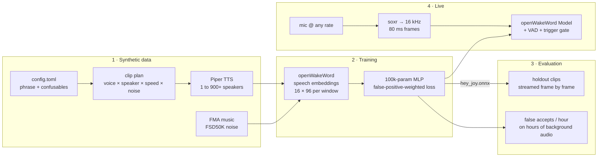

# wakeword-lab

**Train your own wake word without recording anyone.** Pick a phrase, list the phrases it must *not* fire on, and wakeword-lab synthesizes thousands of varied voices with [Piper](https://github.com/OHF-Voice/piper1-gpl), trains a tiny [openWakeWord](https://github.com/dscripka/openWakeWord) classifier, scores it phrase by phrase against its hardest confusables, and listens on your mic in real time.

The worked example is **"Hey Joy"**, a deliberately nasty choice: it sits one vowel away from "Hey Joey", "Hey Joe", "Enjoy" and "Ahoy". If a pipeline can separate those, it can handle your phrase too.



## Highlights

- **Zero recordings required.** Positives and negatives are synthesized. Point it at Piper's multi-speaker LibriTTS-R voice and every clip can come from a different speaker.
- **Adversarial negatives as config.** Hard negatives like "Hey Joey" get a `weight` that multiplies their augmented copies, so the model spends its capacity where mistakes actually happen.
- **Deterministic, resumable synthesis.** Every clip is planned up front (voice, speaker, length scale, noise) and recorded in a `manifest.csv`. Kill it halfway and rerun; it picks up where it stopped.
- **Train/serve parity.** Training windows are extracted by streaming clips through the same `AudioFeatures` pipeline the live detector uses, including warm-up, so what the model learns is exactly what it sees on the mic.
- **Honest evaluation.** Clips are split into train and holdout by a stable hash *before* augmentation. `evaluate` streams each holdout clip through `openwakeword.Model`, takes its peak score and reports hit rate per phrase, so the weakest confusable is the first row after your wake phrase.
- **False accepts per hour.** Feed it openWakeWord's 11-hour validation feature set and it counts distinct activations, with the same refractory window the live listener uses.
- **Optional personalization.** `--enroll` records five takes of your voice plus room tone and weights them heavily. Recordings stay in the local `runs/` folder, which git ignores.
- **Plays nice with real hardware.** Opens whatever rate your interface supports (48 kHz, 44.1 kHz, multi-channel), resamples with a streaming soxr resampler, and can probe every input to find the one you're actually talking into.
- **Tiny output.** The exported ONNX head is about 100k parameters and drops straight into openWakeWord, Home Assistant / Wyoming, or anything else that loads openWakeWord models.

## Quickstart

Python 3.10 or 3.11 recommended.

```bash
git clone https://github.com/joey12725/wakeword-lab
cd wakeword-lab
python -m venv .venv && source .venv/bin/activate   # Windows: .venv\Scripts\activate
pip install -e ".[all]"

# Three Piper voices for the quick config (about 60 MB each)
python -m piper.download_voices --download-dir voices \
    en_US-lessac-medium en_US-amy-medium en_US-ryan-high

wakeword-lab synth                 # ~350 clips into runs/hey_joy/clips
wakeword-lab train                 # embeddings + training -> runs/hey_joy/models/hey_joy.onnx
wakeword-lab evaluate              # per-phrase scorecard on held-out clips
wakeword-lab listen                # live meter; say "Hey Joy"
```

Or run the whole loop in one go, including a mic check and optional voice enrollment:

```bash
wakeword-lab demo --probe --enroll
```

`wakeword-lab devices` lists inputs; `--device <index or name>` and `--channel <n>` pick one explicitly. Every command takes `-c path/to/config.toml` (default `configs/hey_joy.toml`).

### Your own phrase

Copy `configs/hey_joy.toml`, change `phrase`, and rewrite the `[[negative]]` list with whatever sounds closest to it. Rhymes, the phrase minus its first word, the name of a family member that shares a syllable, other assistants' wake words.

```toml
[wakeword]
phrase = "Okay Toaster"

[[positive]]
text = "Okay Toaster."
clips = 150

[[negative]]
text = "Okay Toast."
clips = 40
weight = 4
```

## Going big

`configs/hey_joy_large.toml` is the full-scale recipe: 5,000 positives and 5,500 adversarial negatives across Piper's 900-speaker LibriTTS-R voice plus three single-speaker voices, 8,000 slices of public music and sound-effect audio as background negatives, and a false-accept-per-hour check.

```bash
python -m piper.download_voices --download-dir voices en_US-libritts_r-medium
wakeword-lab negatives --validation          # FMA + FSD50K samples, openWakeWord validation features
wakeword-lab synth    -c configs/hey_joy_large.toml
wakeword-lab train    -c configs/hey_joy_large.toml
wakeword-lab evaluate -c configs/hey_joy_large.toml \
    --fp-features data/negatives/validation_set_features.npy
```

| Adversarial phrase | Clips | Why it's there |
| --- | ---: | --- |
| Hey Joey | 2,000 | One vowel away. The single most likely false trigger. |
| Hey Joe | 1,000 | Same onset, truncated. |
| Hey Joyce | 500 | Same onset, extra consonant. |
| Enjoy | 500 | Contains "joy" mid-word. |
| Ahoy | 500 | Same rhyme, different onset. |
| Joy / Joey | 500 each | The name without "hey". |

Training uses CUDA when it's available and falls back to CPU.

## What `evaluate` reports

```
  phrase        want  clips  mean peak  fired @0.65
  -------------------------------------------------
  Hey Joy.      fire    ...
  Hey Joey.     skip    ...
  Enjoy.        skip    ...
```

Positives come first, then negatives sorted from most to least confusing, followed by overall recall, the clip-level false-accept rate and (with `--fp-features`) false accepts per hour. The same numbers land in `runs/<name>/models/<name>.eval.json`, next to the per-epoch training history in `<name>.train.json`.

## Project layout

```
configs/            hey_joy.toml (quick) and hey_joy_large.toml (full scale)
src/wakeword_lab/
  config.py         TOML schema + validation
  synth.py          clip planning, manifest, Piper synthesis
  negatives.py      FMA / FSD50K / validation-feature downloads
  features.py       openWakeWord embedding windows + speech-window selection
  dataset.py        holdout split, augmentation, background slicing
  train.py          MLP head, weighted BCE, early stopping, ONNX export
  evaluate.py       streaming per-phrase scorecard + false accepts/hour
  metrics.py        pure-NumPy metric helpers
  devices.py        input discovery, capture config, loudest-mic probe
  listen.py         live loop, trigger gate, enrollment
  cli.py            `wakeword-lab` command
tests/              unit tests for everything that doesn't need a GPU or a mic
docs/               pipeline internals and full config reference
```

More detail: [docs/pipeline.md](docs/pipeline.md) walks through each stage, and [docs/configuration.md](docs/configuration.md) lists every config key.

## Tech stack

Python · [openWakeWord](https://github.com/dscripka/openWakeWord) (melspectrogram + speech-embedding front end, Silero VAD) · [Piper](https://github.com/OHF-Voice/piper1-gpl) TTS · PyTorch → ONNX · ONNX Runtime · NumPy / SciPy · soxr · sounddevice · pytest + ruff on GitHub Actions.

## Development

```bash
pip install -e ".[dev]"
ruff check . && ruff format --check .
pytest
```

The test suite needs only NumPy and SciPy, so it runs in seconds on CI without Piper, PyTorch or audio hardware.

---

Built by Joey Hersh. MIT licensed. Piper (GPL-3.0) is an optional dependency, and Piper voices, openWakeWord models and the FMA / FSD50K samples carry their own licenses; check them before shipping a model trained on them.
